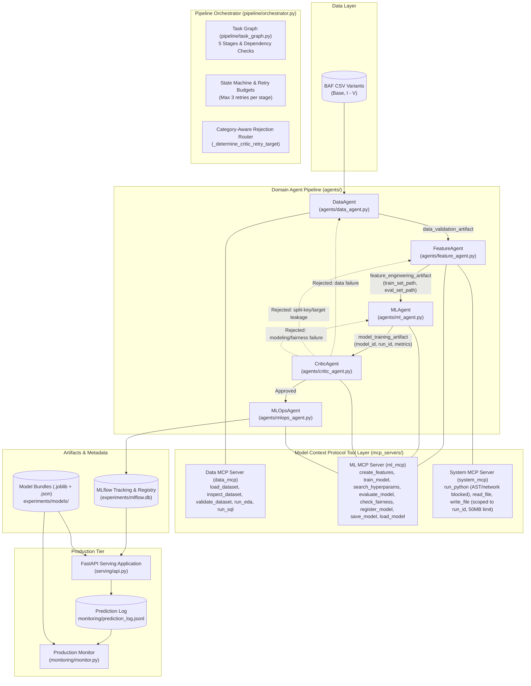
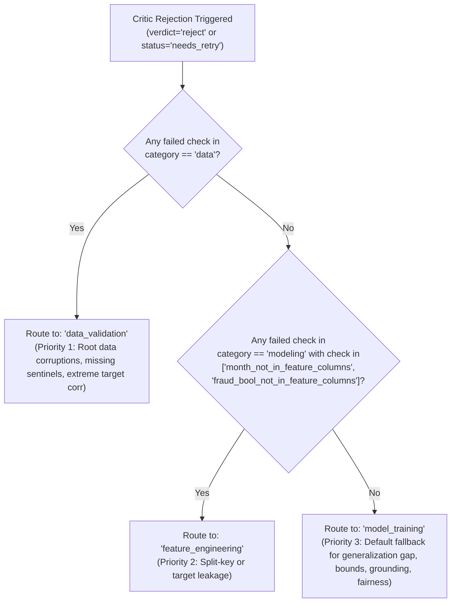

# Argus ML — System Architecture

Argus is an autonomous multi-agent machine learning engineering platform designed for the Bank Account Fraud (BAF) tabular dataset. The platform executes an end-to-end ML lifecycle without manual intervention: data ingestion and deterministic validation, leakage-free temporal feature engineering, multi-candidate model training and hyperparameter search, deterministic Critic gating across quality and fairness, MLflow model registry publication, real-time FastAPI serving, and continuous production monitoring.

---

## 1. High-Level Architecture Diagram



---

## 2. Five-Agent Pipeline and Responsibilities

The system structures the machine learning engineering workflow into five specialized autonomous agents extending `agents.base.Agent`:

| Agent | Module Path | Primary Responsibility | Key Inputs | Key Artifact Outputs |
| :--- | :--- | :--- | :--- | :--- |
| **DataAgent** | `agents/data_agent.py` | Ingests BAF dataset variant, executes deterministic validation, runs exploratory analysis (EDA), and generates structured data quality report. Enforces mandatory deterministic issue logging. | `dataset_variant`, `task_id` | `dataset_path`, `row_count`, `column_count`, `validation`, `eda`, `issues_found` |
| **FeatureAgent** | `agents/feature_agent.py` | Generates train and evaluation feature matrices using non-configurable temporal splitting (months 0–5 train, months 6–7 eval). Drops high-correlation pairs (|corr| > 0.90) to eliminate multicollinearity. Enforces code-level self-check preventing `month` or `fraud_bool` from leaking into feature columns. | `dataset_path`, `high_correlation_pairs` | `train_set_path`, `eval_set_path`, `feature_set_path`, `manifest` (`split_method`, `feature_columns`, `train_months`, `eval_months`) |
| **MLAgent** | `agents/ml_agent.py` | Trains multiple candidate algorithms (Logistic Regression baseline, Random Forest, XGBoost, and PyTorch Tabular MLP). Conducts hyperparameter search for tree-based models on training holdouts without touching eval sets. Evaluates all candidates on fixed eval sets and selects winning model with grounded metric justification. | `train_set_path`, `eval_set_path` | `model_id`, `model_path`, `model_type`, `train_metrics`, `eval_metrics`, `candidates_considered`, `selection_reason` |
| **CriticAgent** | `agents/critic_agent.py` | Rigorous, deterministic quality gatekeeper. Evaluates 15+ automated checks spanning 4 distinct categories (data integrity, modeling/leakage, experiment metric grounding, and algorithmic age fairness). Issues binary `approve` or `reject` verdict. | `data_validation_artifact`, `feature_engineering_artifact`, `model_training_artifact`, `eval_set_path`, `model_id` | `verdict` (`approve`/`reject`), `failed_checks`, `advisory_notes` |
| **MLOpsAgent** | `agents/mlops_agent.py` | Deterministic model publisher. Verifies explicit Critic approval before publishing approved model bundle into the MLflow Model Registry under stage `Staging`. | `model_id`, `run_id`, `critic_verdict`, `registry_name` | `action` (`registered`), `model_id`, `registry_name`, `version`, `stage` (`Staging`) |

---

## 3. Orchestrator Architecture and Execution Lifecycle

The single execution authority across the entire Argus platform is `pipeline.orchestrator.Orchestrator`. It manages stage lifecycles, global task state, retry budgets, timeout enforcement, context propagation, and failure routing.

### Execution Lifecycle

```
[Start run_task / Orchestrator.run]
   │
   ▼
[Initialize TaskState (task_id, dataset_variant, status='running')]
   │
   ▼
┌─► [Evaluate Wall-Clock Timeout (Default: 1800s)] ──── Exceeded? ──► [Fail Pipeline]
│  │
│  ▼
│  [Check Agent Registry for current_stage] ─────────── Missing? ───► [Fail Pipeline]
│  │
│  ▼
│  [TaskGraph Dependency Validation] ────────────────── Missing? ───► [Fail Pipeline]
│  │
│  ▼
│  [Assemble Stage Context & Inject Prior Artifacts]
│  │
│  ▼
│  [Invoke Agent.run(AgentInput)]
│  │
│  ▼
│  [Append StageRecord to state.stage_history]
│  │
│  ├── If Stage == 'critic_review':
│  │   Update MLflow Run Tag: 'critic_verdict' = 'approve' | 'reject'
│  │   If AgentOutput.status == 'needs_retry' or verdict == 'reject':
│  │      Route via _determine_critic_retry_target(failed_checks)
│  │      Increment target stage retry count
│  │      If retry count > MAX_RETRIES_PER_STAGE (3) ──────────────► [Fail Pipeline]
│  │      Enrich target stage context with failed checks & feedback
│  │      Set state.current_stage = target_stage
│  │      LOOP BACK ───────────────────────────────────────────────┘
│  │
│  ├── If AgentOutput.status == 'success':
│  │   Record stage_artifacts[output_artifact_key]
│  │   Advance via TaskGraph.get_next_stage(current_stage)
│  │   If next_stage is None:
│  │      Build final report -> state.status = 'completed' ────────► [Complete Pipeline]
│  │   Else:
│  │      Set state.current_stage = next_stage
│  │      LOOP BACK ───────────────────────────────────────────────┘
│  │
│  ├── If AgentOutput.status == 'needs_retry':
│  │   Increment current_stage retry count
│  │   If retry count > MAX_RETRIES_PER_STAGE (3) ────────────────► [Fail Pipeline]
│  │   Enrich stage context with errors & rationale
│  │   LOOP BACK ──────────────────────────────────────────────────┘
│  │
│  └── If AgentOutput.status == 'failure': ────────────────────────► [Fail Pipeline]
```

### Global State Contracts (`agents/contracts.py`)

- **`TaskState`**: Tracks `task_id`, `dataset_variant`, `current_stage`, `stage_history: list[StageRecord]`, `retry_counts: dict[str, int]`, `status: Literal["running", "halted", "completed", "failed"]`, and `final_report`.
- **`StageRecord`**: Immutable log entry recording `stage`, `agent`, `output: AgentOutput`, `critic_verdict: Literal["approve", "reject"] | None`, and UTC `timestamp`.
- **`AgentInput`**: Payload passed into each agent turn (`task_id`, `stage`, `system_prompt`, `available_tools`, `context`, `retry_count`).
- **`AgentOutput`**: Structured response returned by each agent (`status: Literal["success", "failure", "needs_retry"]`, `artifact: dict | None`, `rationale: str`, `tool_calls: list[ToolCallLog]`, `errors: list[str]`).

---

## 4. Task Graph and Stage Dependencies (`pipeline/task_graph.py`)

Stage progression and dependency requirements are declaratively defined in `pipeline/task_graph.py` as `PIPELINE_STAGES` and managed via `TaskGraph`:

| Stage (`name`) | Direct Dependencies | Required Context Keys | Output Artifact Key |
| :--- | :--- | :--- | :--- |
| `data_validation` | `[]` | `["dataset_variant"]` | `data_validation` |
| `feature_engineering` | `["data_validation"]` | `["dataset_path"]` | `feature_engineering` |
| `model_training` | `["feature_engineering"]` | `["train_set_path", "eval_set_path"]` | `model_training` |
| `critic_review` | `["model_training"]` | `["eval_set_path", "model_id"]` | `critic_review` |
| `mlops_registration` | `["critic_review"]` | `["model_id", "run_id"]` | `mlops_registration` |

---

## 5. Critic Validation and Category-Aware Rejection Routing

The `CriticAgent` (`agents/critic_agent.py`) audits the candidate model against deterministic criteria. When one or more checks fail, the Orchestrator inspects the `failed_checks` list and routes backward using a strict priority ladder (`_determine_critic_retry_target`):



### Context Enrichment on Routing
When routed backward, the destination agent receives enriched context in `stage_contexts`:
- `previous_attempt_errors`: List of errors from the prior attempt.
- `previous_attempt_rationale`: Rationale explaining the prior failure.
- `critic_verdict`: `"reject"`.
- `critic_feedback`: Full Critic output artifact.
- `failed_checks`: Structured list of every check that failed, including `check_name`, `category`, `expected`, `actual`, and `reason`.
- `retry_attempt`: Current retry count against the stage budget (`MAX_RETRIES_PER_STAGE = 3`).

---

## 6. MCP Architecture: Tools and Permissions

Argus implements tool access via the Model Context Protocol (MCP) using a unified `MCPClient` (`mcp_servers/client.py`) and three dedicated servers. Tool specs are wrapped such that LLM tool calls execute via standard JSON-RPC over stdio or internal dispatch.

### Server Scoping and Tool Permissions

| MCP Server | Server Module | Registered Tools | Description & Security Enforcement |
| :--- | :--- | :--- | :--- |
| **Data MCP** | `mcp_servers/data_mcp/server.py` | `load_dataset`<br/>`inspect_dataset`<br/>`run_sql`<br/>`validate_dataset`<br/>`run_eda` | Ingests BAF variants and computes data profiles. `run_sql` validates that queries are strictly read-only `SELECT` or `WITH` statements; destructive keywords (`DROP`, `DELETE`, `UPDATE`, `INSERT`, `ATTACH`, `PRAGMA`) and multi-statement queries are rejected. |
| **ML MCP** | `mcp_servers/ml_mcp/server.py` | `create_features`<br/>`train_model`<br/>`search_hyperparams`<br/>`evaluate_model`<br/>`check_fairness`<br/>`save_model`<br/>`load_model`<br/>`register_model` | Handles feature engineering, model training (LR, RF, XGBoost, PyTorch MLP), hyperparameter tuning, evaluation (PR-AUC, Recall@5%FPR), age fairness calculations, and MLflow Model Registry publication. |
| **System MCP** | `mcp_servers/system_mcp/server.py` | `run_python`<br/>`write_file`<br/>`read_file` | **Tightest locked-down server.**<br/>- `run_python`: Executes in an isolated subprocess with working directory pinned to `experiments/scratch/`, hard 5.0s timeout, AST inspection blocking socket/network imports (`socket`, `http`, `urllib`, `requests`, `aiohttp`, `httpx`), and a `sys.meta_path` import finder.<br/>- `write_file` / `read_file`: Scoped strictly to `experiments/runs/{task_id}/` with path-traversal rejection and a 50MB file size ceiling to prevent disk exhaustion. |

### Least-Privilege Agent Grants
- **`DataAgent`**: Granted only `load_dataset`, `validate_dataset`, `run_eda`, `inspect_dataset`, `run_sql`.
- **`FeatureAgent`**: Granted only `create_features`, `run_python`.
- **`MLAgent`**: Granted only `train_model`, `search_hyperparams`, `evaluate_model`, `save_model`, `load_model`.
- **`CriticAgent`**: Granted **no direct tool calls**; audits provided artifacts deterministically in-process (using `check_fairness` directly).
- **`MLOpsAgent`**: Granted **no direct tool calls**; executes `register_model` directly in-process upon verifying Critic approval.

---

## 7. Error Handling, Retries, and Known Limitations

1. **Retry Budgets**: Every stage maintains an isolated retry count in `state.retry_counts`. If any stage exceeds `MAX_RETRIES_PER_STAGE = 3` (either through autonomous retry requests or Critic rejections), the Orchestrator halts execution and marks the task `failed`.
2. **Wall-Clock Timeout**: The Orchestrator enforces a hard maximum wall-clock timeout (default: 1800.0s).
   > *Limitation Note*: As documented in `pipeline/orchestrator.py`, the timeout guard is evaluated at stage loop boundaries. It prevents runaway retry-loop duration across stage transitions, but does not preemptively interrupt a long-running synchronous in-flight computation within an individual stage.
3. **Structured Logging and Sensitive Data Redaction**: `pipeline/logging.py` provides structured JSON logging with recursive redaction of sensitive credentials (`api_key`, `token`, `secret`, `password`, `credentials`).

---

## 8. Repository Component Structure

```
argus-ml/
├── agents/                  # Autonomous domain agents and runtime
│   ├── base.py              # Base Agent loop, turn management, and error catching
│   ├── contracts.py         # Pydantic data contracts (AgentInput, AgentOutput, TaskState)
│   ├── data_agent.py        # Data ingestion, validation, and EDA agent
│   ├── feature_agent.py     # Temporal feature engineering agent
│   ├── ml_agent.py          # Model training, hyperparameter tuning, and selection agent
│   ├── critic_agent.py      # Deterministic multi-category audit agent
│   ├── mlops_agent.py       # MLflow model registration agent
│   └── llm.py               # LLM abstraction (OpenAI/Anthropic/Gemini) & MockLLMClient
├── pipeline/                # Orchestration and task execution graph
│   ├── orchestrator.py      # Single pipeline execution state machine
│   ├── task_graph.py        # Declarative PIPELINE_STAGES & TaskGraph dependency validator
│   ├── config.py            # Global Settings, timeouts, and MAX_RETRIES_PER_STAGE
│   └── logging.py           # Structured JSON logger with regex-based credential redaction
├── tools/                   # Tool implementations
│   ├── data_tools.py        # Data loading, validation, EDA, SQLite SQL tools
│   ├── ml_tools.py          # Feature creation, training (LR/RF/XGB/Torch), eval, fairness, MLflow
│   └── system_tools.py      # Sandboxed run_python, scoped read_file and write_file
├── mcp_servers/             # Model Context Protocol servers and client router
│   ├── client.py            # Unified MCPClient routing tools to servers
│   ├── data_mcp/            # Data MCP server
│   ├── ml_mcp/              # ML MCP server
│   └── system_mcp/          # System MCP server (sandboxed execution)
├── serving/                 # Real-time production serving
│   ├── api.py               # FastAPI application (/health, /model-info, /predict)
│   └── Dockerfile           # Production container definition
├── monitoring/              # Production reliability and drift detection
│   └── monitor.py           # Latency, prediction drift, feature PSI, delayed PR-AUC degradation
├── skills/                  # Composable multi-tool workflow skills
│   ├── loader.py            # Skill manifest discovery and JSON loader
│   └── schema.py            # Declarative SkillManifest schema
├── eval/                    # Adversarial evaluation harness
│   └── agent_eval/          # 10 adversarial scenarios, rubric scoring, and reporting
├── tests/                   # Comprehensive unit and integration test suite
└── docs/                    # Architecture and design documentation
    ├── architecture.md      # System architecture specification
    └── design-doc.md        # Methodological and engineering design documentation
```

